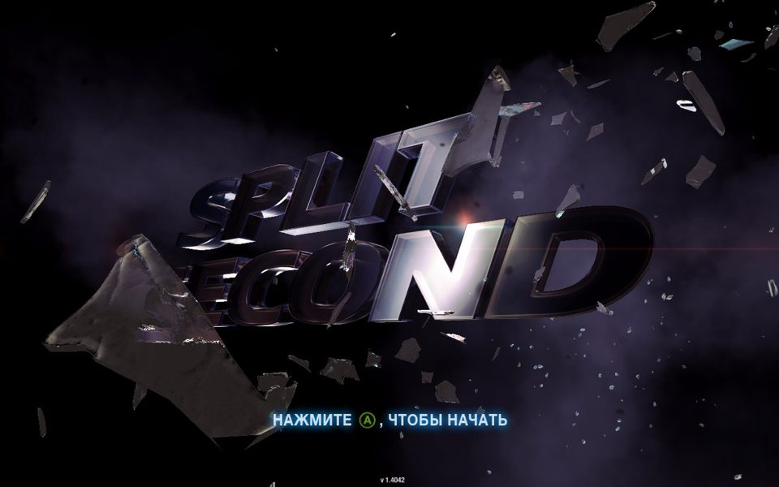
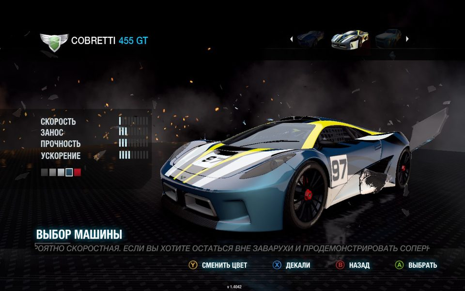
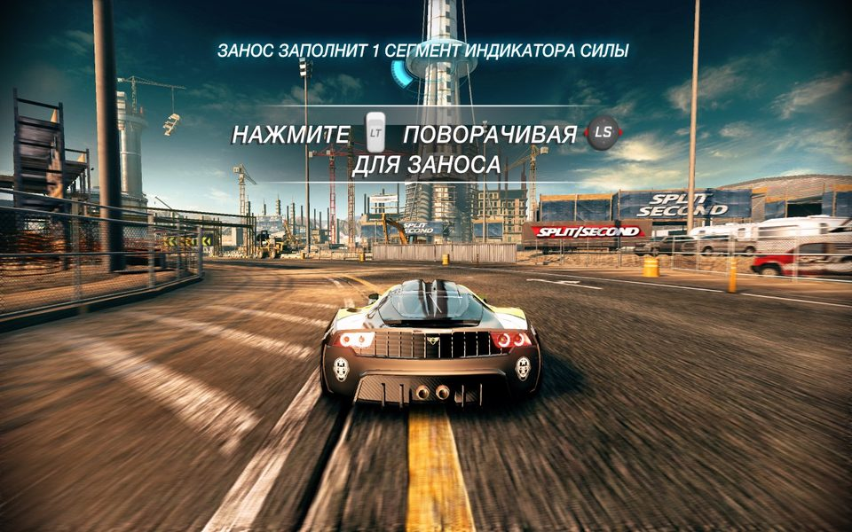

# Split/Second gamepad fix

[English](README.md) | **Русский**



Позволяет играть в PC-версию **Split/Second** (2010) только геймпадом — на Windows или на Steam Deck.

В оригинальной PC-версии геймпад работает только в гонке: все меню требуют клавиатуру, а
подсказки показывают клавиши или сырые названия осей («НАЖМИТЕ ENTER, ЧТОБЫ НАЧАТЬ», «ДЛЯ
УСКОРЕНИЯ НАЖМИТЕ Ось Z Отр»). С этим фиксом:

- **все меню управляются геймпадом** — главное меню, пауза, результаты, настройки;
- **подсказки показывают кнопки Xbox** вместо клавиш: строка подсказок внизу меню, заставка и
  обучающие подсказки в гонке;
- **управление в гонке не меняется** — стики и курки остаются аналоговыми;
- управление один раз выставляется на готовую раскладку для геймпада, ничего не нужно
  назначать вручную.

<p>
  
  
</p>

Проверено на Steam Deck со встроенным геймпадом, с коробочной и со Steam-версией игры. На Windows
так же должен работать любой XInput-геймпад (Xbox One / Series или совместимый). С геймпадом
Xbox 360 игра сама управляет меню; фикс это замечает и только добавляет иконки кнопок.

## Требования

- PC-версия Split/Second: коробочная или из Steam. Установщик проверяет `SplitSecond.exe` и
  откажется работать с другой версией.
- Оригинальный, не изменённый `data/resident.ark`.

## Установка

Скачайте из [релизов](../../releases) архив для своей системы и распакуйте:
`splitsecond-xinput-fix-*-windows.zip` для Windows, `splitsecond-xinput-fix-*-linux.tar.gz` для
Steam Deck / Linux. В каждом — один установщик, в который встроено всё необходимое, и
`INSTALL.txt`.

### Windows

1. Распакуйте архив куда угодно и запустите `ssfix-install.exe`.
   Windows попросит права администратора: папка игры обычно лежит в `Program Files`. Если
   SmartScreen скажет, что приложение не распознано, нажмите **Подробнее → Выполнить в любом
   случае**.
2. Установщик сам найдёт игру — Steam-версию и установленную с диска — и покажет каждую копию с
   состоянием фикса. Выберите копию (если их несколько) и нажмите `i`, чтобы установить, `r` —
   переустановить / обновить, `u` — удалить.

   Если вашей копии нет в списке, скопируйте `ssfix-install.exe` в папку игры (рядом с
   `SplitSecond.exe`) и запустите там: тогда он сразу ставит фикс в эту папку. Или укажите папку
   игры: `ssfix-install.exe "C:\Games\Split Second"`.
3. Запустите игру.

Отдельно ставить DirectX для фикса не нужно.

### Steam Deck / Linux (Proton)

1. В режиме рабочего стола распакуйте архив куда угодно, например в `Загрузки`.
2. Откройте терминал в этой папке (в Dolphin: правой кнопкой по пустому месту →
   **Открыть терминал**) и выполните:
   ```
   ./ssfix-install
   ```
   (если система ответит «Permission denied», сначала выполните `chmod +x ssfix-install`)

   Установщик сам найдёт игру через Steam — Steam-версию и ярлыки на `SplitSecond.exe`, добавленные
   как игры не из Steam, — и покажет все копии с состоянием фикса в каждой:
   ```
   Found Split/Second:
     1. /home/deck/.local/share/Steam/steamapps/common/SplitSecond  [Steam]
        Steam (English) version, fix not installed
     2. /home/deck/Games/Split Second  [Steam shortcut "Split/Second"]
        retail version, fix installed (this version)

   Choose a game [1-2], or q to quit:
   ```
   Введите номер, затем **i** — установить, или **r** — переустановить / обновить, **u** — удалить.

   Если вашей копии нет в списке (она не добавлена в Steam), укажите её папку — замените путь на
   папку, где лежит *ваша* игра:
   ```
   ./ssfix-install "/home/deck/Games/Split Second"
   ```
   Если запустить установщик из самой папки игры, он сразу работает с ней, ничего не спрашивая.
3. В Steam Input используйте обычную раскладку геймпада, клавиши не нужны.
4. Запустите игру.

Proton загружает фикс только с переопределением DLL. Установщик сам прописывает его в префикс
Proton игры — и для Steam-версии, и для ярлыка на игру не из Steam, — а при удалении убирает. Если
сделать это не получилось (игру ещё ни разу не запускали или она сейчас запущена), он об этом
скажет; тогда запустите или закройте игру и запустите установщик ещё раз, либо добавьте в Steam в
**Свойства → Параметры запуска** игры:
```
WINEDLLOVERRIDES="xinput1_3=n,b" %command%
```

Работают и Proton 11.0, и Proton Experimental. Со Steam-версией Proton Experimental выдаёт
геймпад за Xbox 360, и игра сама управляет меню; фикс это замечает и только добавляет иконки
кнопок.

## Управление

| | В меню | В гонке |
|---|---|---|
| D-pad / левый стик | выбор | левый стик — руль |
| A | подтвердить | PowerPlay 1 уровня |
| B | назад | PowerPlay 2 уровня |
| X / Y | дополнительные действия из строки подсказок | Y — камера |
| RT / LT | — | газ / тормоз |
| Правый стик | — | обзор |
| Start | назад | пауза |

При первом запуске после установки управление выставляется на эту раскладку. Потом его можно
менять в настройках игры, изменения сохранятся.

## Удаление

Запустите в папке игры **`Uninstall gamepad fix.bat`** (Windows) или
**`uninstall-gamepad-fix.sh`** (Linux / Steam Deck) — установщик кладёт их туда сам. Файлы игры
восстанавливаются в точности такими, какими были. Если вы добавляли параметр запуска вручную, уберите и его. На Windows копия установщика в
`ssfix\` удаляется при следующей перезагрузке (работающая программа не может удалить сама себя).

## Обновления Steam и смена языка

В Steam-версии `SplitSecond.exe` и `data/resident.ark` приходят вместе с языковым пакетом. Смена
языка игры в Steam, обновление игры или **Проверка целостности файлов** заменяют их, и патч из
архива пропадает. Перед сменой языка удалите фикс (тогда файлы в точности оригинальные, и Steam
спокойно их обновит), а после — снова запустите установщик. Если Steam уже заменил файлы, просто
запустите установщик ещё раз: он это заметит и пропатчит новый архив.

Поддерживаются все семь языков Steam-версии (английский, французский, немецкий, итальянский,
испанский, польский, русский) и коробочная версия. У английского, французского, немецкого,
итальянского и испанского файлы общие, поэтому при переключении между ними фикс остаётся; при
переходе на польский или русский и обратно файлы заменяются, и установщик нужно запустить снова.

## Если что-то не так

- **Установщик пишет, что архив отличается от оригинала.** `data/resident.ark` уже изменён другим
  модом или это другая версия игры. Сначала верните оригинальный файл.
- **На Steam Deck в меню ничего не изменилось.** Посмотрите, что установщик написал про префикс
  Proton; если изменить его не удалось, добавьте параметр запуска выше.
- **В меню каждое нажатие сдвигает на два пункта.** Создайте issue и приложите лог: игра сама
  управляет этим геймпадом, а фикс его не распознал.
- Фикс пишет лог в `Documents\ss_xinput_fix.log` (в Proton — внутри префикса игры,
  `.../pfx/drive_c/users/steamuser/Documents/`).

## Для разработчиков

Как устроен фикс, форматы файлов игры, инструменты и сборка описаны в [`docs/`](docs):
[устройство фикса](docs/implementation.ru.md), [инструменты и форматы](docs/tooling.ru.md),
[сборка и CI](docs/building.ru.md).
